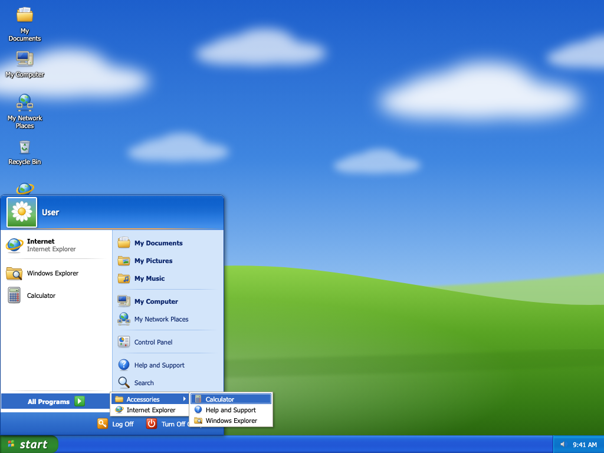

# webxp

A Windows XP–style desktop that runs entirely in your browser. You can:
- open, move, resize, minimize and maximize windows;
- browse and organize folders in Explorer, with a Recycle Bin and undo;
- use the Start menu, taskbar, Calculator, Control Panel, Task Manager and Help.

It works by mouse, keyboard or touch.

It's a web page, not an operating system or emulator:
- It stores only empty **folders** in your browser.
- It never touches your real files.
- It makes no network requests after loading.



> **Not affiliated with Microsoft.** Windows, Windows XP and Internet Explorer are trademarks of Microsoft Corporation, used here only to describe what this project imitates. All artwork is original and generated by a script in this repository; no Microsoft images, icons, fonts or sounds are included (see [docs/ASSETS.md](docs/ASSETS.md)). The wallpaper is an original stand-in, not "Bliss".

## Run locally

You need [Node.js](https://nodejs.org/) 24 or later, which includes npm.

1. Clone the repository and enter it:
   ```sh
   git clone https://github.com/Sidratul-CMD2/webxp.git
   cd webxp
   ```
2. Install dependencies:
   ```sh
   npm install
   ```
3. Start the development server:
   ```sh
   npm run dev
   ```
4. Open http://localhost:5173 in your browser.

To try the optimized production build instead, run `npm run build`, then `npm run preview`, and open http://localhost:4173.

Your folders and settings are saved in the browser. To start over, use **Control Panel › Accessibility Options › General › Reset Simulation…**.

## Commands

For browser tests, first install Playwright's browsers with `npx playwright install`.

| Purpose | Command |
|---|---|
| Install | `npm install` |
| Development server | `npm run dev` (http://localhost:5173) |
| Production build | `npm run build` (typecheck, then `vite build` into `dist/`) |
| Preview the build | `npm run preview` (http://localhost:4173) |
| Typecheck | `npm run typecheck` |
| Lint | `npm run lint` |
| Unit and component tests | `npm test` |
| One unit test | `npx vitest run tests/unit/fs.test.ts -t "name"` |
| Browser tests, one browser | `npx playwright test --project=chromium` (or `webkit`, `firefox`) |
| Browser tests, all browsers | `npm run test:e2e` |
| Screenshots | `npm run screenshots` (writes `docs/screenshots/`) |
| Everything local | `npm run check` (typecheck, lint, unit tests, build) |
| Regenerate artwork | `node scripts/generate-assets.mjs` |

Browser tests build the app and serve it with `vite preview` on port 4173. Outside CI, an already-running preview server is reused, and it serves whatever is in `dist/`. Run `npm run build` first if you changed code.

The build uses a relative base (`./`), so `dist/` can be served from any static path.

## Saved state and reset

- **What is saved:** folders, Recycle Bin contents, desktop icon positions and preferences. They live in this browser's `localStorage` under the single key `xp-sim:v1`.
- **What is not saved:** open windows, the clipboard, undo, menus and drafts.
- **When it saves:** folder changes save immediately. Preference changes save after a short delay. Everything is flushed when the page is hidden.
- **When saving pauses:** if the saved data is corrupt or from a newer version, or another tab changes it, saving pauses and the app asks what to do. It never silently overwrites.
- **If storage is unavailable:** the session keeps working and shows a notice.
- **Reset:** **Control Panel › Accessibility Options › General › Reset Simulation…**, or the Help topic "Reset the simulation". After confirmation it erases only this app's key and restores the starting folders.

## Project layout

| Path | Contents |
|---|---|
| `src/domain/` | Pure logic: folder tree, locations, decimal calculator, window manager, preferences, persistence, Run allowlist |
| `src/state/` | The store, the single command layer, and actions for windows, Explorer, folders, dialogs and the session |
| `src/shell/` | Desktop, windows, taskbar, Start menu, dialogs, selection and drag handling |
| `src/ui/` | Shared XP controls: menus, toolbar, tree, dialog, property sheet, icons |
| `src/apps/` | Explorer, Calculator, Control Panel and applets, Task Manager, Help, browser |
| `src/styles/` | Theme tokens and component styles, including compact, high-contrast and forced-colors |
| `tests/unit/` | Domain, contrast and component tests (Vitest, jsdom, Testing Library) |
| `tests/e2e/` | Playwright flows by QA ID, axe scans and screenshots |

## Current status and limitations

The phase gates and final test results are in [docs/PLAN.md](docs/PLAN.md). In short:

**Browser coverage:**
- Chromium (118/118) and Playwright WebKit (83 passed; 35 Chromium-only tests skipped) pass the browser suites. 119/119 unit and component tests pass.
- Playwright's Firefox build could not start on the macOS 27.2 development machine, so Firefox is untested.
- Playwright WebKit is not shipping Safari.
- A manual check in Safari on macOS was done. VoiceOver has not been tested yet (a checklist is in [docs/ACCESSIBILITY.md](docs/ACCESSIBILITY.md)); NVDA (Windows-only) has not been tested.

**Test method limits:**
- Zoom is tested by simulating 200% and 400% as small viewports, not true browser zoom.
- Visual comparison is judgment-based, because no permission-cleared XP reference captures were available.

**Keyboard:**
- In Safari, Tab skips buttons unless "Press Tab to highlight each item" is on. Use Option+Tab.

## Instruction pack

This project was built from an instruction pack. Its documents in `docs/` remain the specification:

| File | Purpose |
|---|---|
| [docs/PRODUCT.md](docs/PRODUCT.md) | Baseline, scope, empty-folder policy and feature inventory |
| [docs/INTERACTIONS.md](docs/INTERACTIONS.md) | Behavior contracts |
| [docs/VISUAL.md](docs/VISUAL.md) | Visual calibration and asset policy |
| [docs/ARCHITECTURE.md](docs/ARCHITECTURE.md) | Implemented architecture and state boundaries |
| [docs/ACCESSIBILITY.md](docs/ACCESSIBILITY.md) | Keyboard, assistive technology and browser adaptations |
| [docs/PLAN.md](docs/PLAN.md) | Phases, exit gates and gate status |
| [docs/QA.md](docs/QA.md) | Acceptance tests and release evidence |
| [docs/RESEARCH.md](docs/RESEARCH.md) | Sources, confidence and historical limitations |
| [docs/ASSETS.md](docs/ASSETS.md) | Asset provenance manifest |
| [docs/REFERENCE.md](docs/REFERENCE.md) | Reference board, deviations and screenshot index |

## License

[MIT](LICENSE) © 2026 Sidratul Adib. The license covers this project's code and original artwork. It grants no rights to Microsoft's trademarks.
